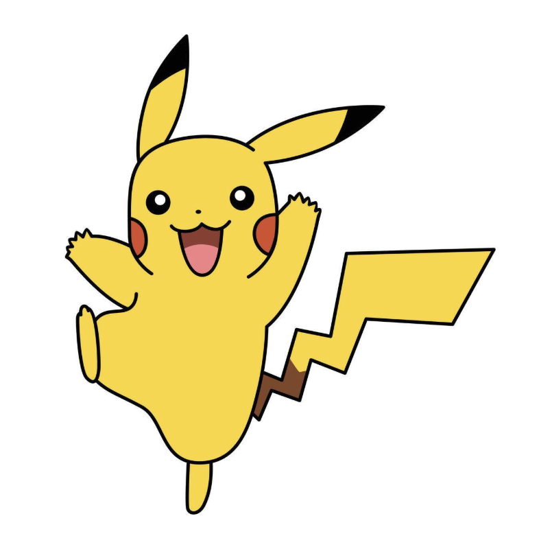

# Bead Pattern Generator

A Python application that converts pixel art, anime characters, and game character images into **perler bead patterns**.

The application provides a simple graphical user interface (GUI), allowing users to select an image, choose a pegboard size, and generate a numbered bead pattern using a palette of 144 bead colors.

## Features

- **Image Upload** — Supports PNG, JPG, and JPEG images.
- **Pegboard Size Selection** — Choose between 30 × 30, 60 × 60, and 90 × 90 pegboards.
- **Automatic Image Resizing** — If an image is larger than the selected pegboard, the application asks whether to resize it while maintaining its aspect ratio.
- **Lab Color Matching** — Uses the CIELAB color space to find the closest available bead color.
- **144 Bead Colors** — Matches images against a predefined palette of 144 approximate RGB colors.
- **Transparency Support** — Fully transparent pixels are treated as empty spaces rather than beads.
- **Numbered Pattern Generation** — Each bead position is labeled with its corresponding color code.
- **Bead Counting** — Calculates the total number of beads and the number of different colors required.
- **Custom File Saving** — Users can choose both the output filename and the destination folder.
- **Overwrite Protection** — Requests confirmation before replacing an existing file.

## Example Images

The repository includes two sample images for testing the application.

| Mario | Pikachu |
|---|---|
|  |  |

These images can be selected through the GUI to generate bead patterns.

## Installation

### 1. Clone the Repository

```bash
git clone https://github.com/Q-Matt/Bead-Pattern-Generator.git
cd Bead-Pattern-Generator
```

### 2. Create a Virtual Environment

```bash
python3 -m venv .venv
```

Activate the virtual environment.

**macOS / Linux:**

```bash
source .venv/bin/activate
```

**Windows (PowerShell):**

```powershell
.venv\Scripts\Activate.ps1
```

### 3. Install Dependencies

```bash
python -m pip install -r requirements.txt
```

The application uses Python and libraries including Pillow, NumPy, and scikit-image. Tkinter is also required for the graphical interface and may need to be installed separately depending on your Python distribution.

## How to Use

### Run the GUI

```bash
python gui.py
```

### Generate a Bead Pattern

1. Click **Browse Image** and select a PNG, JPG, or JPEG image.
2. Select a pegboard size: **30 × 30**, **60 × 60**, or **90 × 90**.
3. Enter a name for the output file.
4. Click **Browse** under **Save Location** to select the destination folder.
5. Click **Generate Lab Pattern**.
6. If the image is too large, choose whether to resize it.
7. Once processing is complete, the application saves the generated bead pattern as a PNG file.

For example, entering `Mario` as the filename will generate:

```text
Mario_lab.png
```

The generated image contains a numbered grid showing the bead color required at each position.

## How It Works

The program follows five main steps:

1. **Image Processing:** Load the selected image, check its dimensions, and optionally resize it to fit the pegboard.
2. **Pegboard Placement:** Center the image on a transparent board of the selected size.
3. **Color Matching:** Convert image pixel colors and the available bead colors into the CIELAB color space and select the closest match using color distance.
4. **Pattern Generation:** Create a grid containing the bead color code for each non-transparent pixel.
5. **Export:** Draw the numbered pattern and save it as a PNG file.

## Project Structure

```text
Bead-Pattern-Generator/
├── gui.py
├── main.py
├── core/
│   ├── image_processor.py
│   ├── color_matcher.py
│   └── pattern_generator.py
├── data/
│   └── bead_colors.py
├── assets/
│   └── examples/
│       ├── mario.png
│       └── pikachu.png
├── output/
├── tests/
├── requirements.txt
├── README.md
└── .gitignore
```

### Main Components

| File | Description |
|---|---|
| `gui.py` | Tkinter graphical user interface |
| `main.py` | Command-line application entry point |
| `core/image_processor.py` | Image loading, resizing, and pegboard placement |
| `core/color_matcher.py` | RGB and Lab color matching algorithms |
| `core/pattern_generator.py` | Bead pattern generation, counting, and rendering |
| `data/bead_colors.py` | Predefined bead color palette |

## Current Limitations

- The bead palette contains approximate RGB values rather than calibrated measurements of physical beads.
- Generated colors may differ from the original image due to the limited color palette and color matching process.
- Large images must be reduced to fit the selected pegboard size, which may remove fine details.
- The application does not automatically remove image backgrounds.
- The generated pattern is saved as a PNG file; an in-app pattern preview is not currently available.

## Technologies Used

- Python
- Tkinter
- Pillow
- NumPy
- scikit-image

## Future Improvements

Potential future enhancements include:

- Previewing original images and generated patterns directly in the GUI.
- Exporting a detailed bead color inventory.
- Improving color accuracy through calibrated bead palettes.
- Supporting additional pegboard sizes.
- Exporting patterns as printable PDF files.

## License

No license has been specified for this project yet.